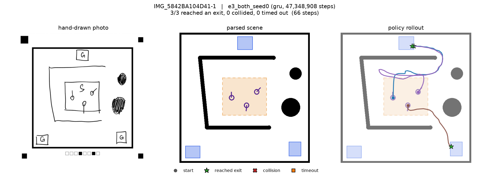
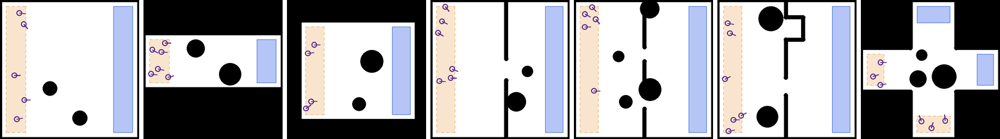

# Learning Multi-Agent Steering Policies from Scene Images with Convolutional Perception and Deep Reinforcement Learning

**Daniel Hu** · Oxford College of Emory University · Advisor: Dr. Hai Le
Undergraduate research project, Fall 2026

<p align="center">
  
  <br>
  <em>Left: hand-drawn input. Middle: the parsed scene. Right: the shared policy driving all three agents to an exit.</em>
</p>

## Overview

Steering behavior describes how a mobile agent moves toward a goal while avoiding obstacles, walls and other agents. It is usually written by hand. The automated model discovery framework of Le and Hu [1, 2] instead searches for it with a genetic algorithm over a symbolic space of sensing, filtering and acting rules.

This project takes a third route: learn the behavior, and learn it starting from a picture. A convolutional network parses a scene image, currently a photo of a hand drawing, into a structured description, and a reinforcement learning policy drives every agent in that scene from a local, ego-centric observation. The output is the path each agent walks to its goal. There are no hand-labeled images and no hand-written steering rules; the renderer produces the labels, and the policy learns from reward.

The symbolic search and the learned policy can be run on the same scenarios with the same metrics, so a direct comparison between the two is planned (E6).

## Pipeline

| Stage | Component | Input → Output |
|---|---|---|
| 1 | Scene image | drawing photo or render → 512 × 512 image |
| 2 | U-Net with instance head | image → 6-class label map and agent heatmap |
| 3 | Geometry extraction | network output → agent poses, obstacles, walls, start and exit regions |
| 4 | Scene instantiation | structured description → simulator state |
| 5 | Ego-centric observation | simulator state → 50 numbers per agent per step |
| 6 | Shared policy (own PPO, GRU memory) | observation → (turn, speed) |
| 7 | Synchronous simulation | actions → trajectories |
| 8 | Path rendering | trajectories → paths drawn over the scene |

Generality comes from the observation. Each agent casts 16 rays spread evenly over its field of view (220°, range 22 in a 100 × 100 world) and reads the nearest hit separately for three entity categories: obstacles, walls and other agents. That gives 48 numbers; goal bearing and the agent's own speed complete the 50. There is no goal distance, no map and no absolute position, so a corridor is just a set of near readings in the same format as any other layout. Rays, not full sectors: beyond about 17 units another agent can fall between two rays and go unseen. All agents share one policy and step synchronously.

## Repository layout

| Path | Contents |
|---|---|
| [`sim/`](sim/) | Scene generator and multi-agent simulator: ten layout families, pixel-exact label maps, JSON ground truth, configuration-space validation. See [`sim/README.md`](sim/README.md). |
| [`perception/`](perception/) | U-Net and geometry extraction trained on `sim/` output, hand-drawn input (current model: v7, `models/sketch7/`), and the design for further input types ([`DESIGN_INPUTS.md`](perception/DESIGN_INPUTS.md)). See [`perception/README.md`](perception/README.md). |
| [`policy/`](policy/) | Multi-agent PPO, E2 and E3 experiments, ORCA baseline, end-to-end demo. See [`policy/README.md`](policy/README.md). |
| [`pilot/`](pilot/) | Earlier end-to-end pilot (128 × 128, single agent). See [`pilot/README.md`](pilot/README.md). |
| [`docs/`](docs/) | Proposal, [pending proposal revisions](docs/PROPOSAL_REVISIONS.md), [compute request](docs/COMPUTE_REQUEST.md), figures. |
| [`requirements.txt`](requirements.txt) | Python dependencies. |

## Scene generator

<p align="center">
  
  <br>
  <em>Seven of the ten layout families: open, corridor, room, doorway, two-doorway, cul-de-sac, crossing. The other three (boxrooms, walls_multi, rooms_multi) have several start and exit boxes. Orange: spawn regions. Blue: goal regions. Black: obstacles and walls.</em>
</p>

Each scene is written as an RGB image, a label map whose pixel values are class indices, and a JSON file with exact agent poses, obstacle geometry, wall segments and regions.

Scenes are validated in configuration space before they are written. Obstacles are inflated by the agent radius with a Euclidean distance transform, so the check "a disk of radius *R* fits here" is exact rather than approximated on a grid. The tightest passage from start to goal is measured and stored with the scene as a difficulty label. Obstacles are placed one at a time and the check is re-run after each placement, so a scene cannot end up sealed.

Throughput on a single laptop CPU core:

| Operation | Cost |
|---|---|
| Scene sample + validate + render + write | 50 ms (about 20 scenes/s) |
| Simulation step | 0.07 ms per agent-step (about 14,000 agent-steps/s) |
| Render 512 × 512 with labels | 8.1 ms |
| Disk footprint | 15.4 KB per scene |

Cul-de-sac and crossing were designed as hard cases for a locally sensing policy. From outside, a sealed pocket looks the same as a real exit, and at a crossing the agents have to avoid each other rather than static geometry. Per-layout results are in [`policy/results/e3/table_e3.md`](policy/results/e3/table_e3.md).

## Results

### Hand-drawn perception (v7)

`scene_usable` is the share of scenes parsed well enough to simulate, on synthetic sketch test sets with about 500 to 1,000 scenes each (one seed):

| Test set | Agent F1 | `scene_usable` |
|---|---|---|
| `test_sketch7` | 0.986 | 88.1% |
| `test_sketch7_free` | 0.992 | 91.2% |
| `test_sketch7_tilt` | 0.987 | 88.8% |
| `test_sketch7_lines` | 0.988 | 85.6% |

On 9 real drawings, a visual review found all 9 parses usable, with one tilted box made axis-aligned and overlapping agents in one drawing. Five of the 9 influenced v7, so this is not an independent test; an independent drawing set is still to be collected.

### Steering policy (E2, E3, ORCA)

Ten layouts, 2 to 8 agents, ground-truth scenes, fixed `test4` suite (100 scenes per layout, 4 agents). Learned rows are mean ± std over seeds: 5 for E2, 3 for E3. Baselines are one run each.

| Method | Information | Success | Collision | Timeout |
|---|---|---|---|---|
| Greedy | goal bearing | 24.2% | 75.7% | 0.0% |
| `orca_straight` | goal bearing, exact nearby geometry and agents | 61.7% | 25.8% | 12.5% |
| E2 `mlp` | rays, bearing, speed | 81.7 ± 0.6% | 9.1 ± 1.6% | 9.3 ± 1.6% |
| E2 `gru` | rays, bearing, speed | 88.4 ± 2.7% | 8.0 ± 2.6% | 3.6 ± 0.8% |
| E3 `e3_both` (validation winner) | rays, bearing, speed | 89.3 ± 1.3% | 7.8 ± 1.3% | 2.9 ± 0.1% |
| `orca_path` | as `orca_straight`, plus a full map and shortest paths | 90.4% | 7.9% | 1.7% |

The policy clearly beats ORCA without route information and ties ORCA with a map, while using less information than either. The reward variants of E3 differ by less than seed noise. These test scenes come from the same layout families the policy trained on; transfer to unseen layouts (E4) has not been measured yet.

### End to end

[`policy/scripts/demo_e2e.py`](policy/scripts/demo_e2e.py) runs drawing → parsed scene → policy rollout on the 9 drawings with one policy seed: 75% of 40 agents reached an exit, 25% collided, none timed out ([per-drawing table](policy/results/demo_e2e/summary.md)). Most failures come from two drawings. This is a demonstration on a small non-independent set, not an evaluation, and the rollouts run inside the parsed scene.

## Earlier pilot

The pilot in [`pilot/`](pilot/) runs the full image → parse → simulate → path chain on a laptop CPU, with a single agent at 128 × 128 resolution. The policy is trained only on open scenes with 1 to 3 obstacles. Corridor layouts are held out and used for zero-shot evaluation.

Perception (U-Net trained on renderer-emitted labels, 60 validation scenes): 99.7% pixel accuracy, obstacle count recovered in 100% of scenes, mean agent-center error 0.5 world units, mean heading error 5.3°.

Policy (PPO, 100 episodes per condition) against a go-straight baseline. "Policy only" runs on ground-truth geometry; "end-to-end" runs the full image → parse → simulate chain with the best of the three seeds:

| Layout | Go-straight baseline | PPO, policy only (mean of 3 seeds) | PPO, end-to-end pipeline (best seed) |
|---|---|---|---|
| Single obstacle | 79% | 100% | 100% |
| Multi-obstacle (held-out random) | 46% | 99% | 98% |
| Corridor (zero-shot) | 22% | 75% | 66% (82% with oracle geometry) |

End-to-end evaluation: the policy acts inside the parsed scene, so perception errors propagate, and the resulting trajectory is checked against the ground-truth scene. An oracle condition (policy on ground-truth geometry) separates the cost of perception from the cost of the policy. On the zero-shot corridor, success is 66% through the full pipeline and 82% with oracle geometry, with no parse failures.

## Status

| Stage | Status | Notes |
|---|---|---|
| Scene generator (`sim/`) | Done | 10 layout families |
| Pilot (`pilot/`) | Done | Single agent, 128 px |
| Hand-drawn perception (`perception/`) | v7 done | Independent drawing test still to do |
| E1, perception and behaviour gap | Partly done | Perception metrics done; same policy on parsed vs true scenes in progress |
| E2, baseline policy | Done | `mlp` vs `gru`, 5 seeds |
| E3, reward | Done | Timeout penalty, geodesic progress, 3 seeds |
| ORCA baseline | Done | `orca_straight`, `orca_path` |
| E4, layout transfer | In progress | Leave-one-layout-out |
| Floor plan and satellite input | Designed | [`DESIGN_INPUTS.md`](perception/DESIGN_INPUTS.md); not trained |
| E5, E6 | Planned | |

## Experiment plan

- **E1, perception and behaviour gap.** Perception metrics, then the same policy on parsed and ground-truth scenes to measure what perception error costs in behaviour.
- **E2, baseline policy.** Memoryless vs GRU shared policy across ten layouts.
- **E3, reward sensitivity.** Reward changes tested against the E2 baseline; the winner carries forward.
- **E4, layout transfer.** Leave-one-layout-out: train on nine layouts, test on the tenth, rotate.
- **E5, crowd size.** Performance as the number of agents grows. The resolution and augmentation sweep called "E5" inside `perception/` predates this numbering.
- **E6, comparison with discovered models.** The same scenarios and metrics as the symbolic framework, plus distilling the policy into a small decision tree.

Further input types (floor plans, satellite images) parsing into one scene format are the planned scale-up. Proposal changes that are agreed but not yet in the PDF are tracked in [`docs/PROPOSAL_REVISIONS.md`](docs/PROPOSAL_REVISIONS.md).

## Quickstart

Python 3.10 or newer.

```bash
git clone https://github.com/danielxhu/cnn-rl-multi-agent-steering.git
cd cnn-rl-multi-agent-steering
python3 -m venv .venv && source .venv/bin/activate
pip install -r requirements.txt
```

Generate scenes and run the generator's tests:

```bash
cd sim
python generate.py --n 10 --layout mixed --preview 10 --out data/preview  # one scene per layout
python generate.py --n 3000 --layout mixed --agents 3-8 --obstacles 2-6 --seed 0 --out data/train
python tests/run_tests.py
```

Run the perception and policy tests (CPU), from `perception/` and `policy/`:

```bash
python tests/run_tests.py
```

Training and evaluation commands are in [`perception/README.md`](perception/README.md) and [`policy/README.md`](policy/README.md).

Reproduce the pilot (about 25 minutes on a laptop CPU, no GPU needed):

```bash
cd pilot
python perception.py        # U-Net -> results/unet.pt
python train_rl.py 0 1 2    # PPO, 3 seeds -> results/ppo_seed{0,1,2}.zip
python evaluate.py          # policy vs. baseline -> results/policy_metrics.json
python end_to_end.py        # image -> path figures and pipeline-vs-oracle metrics
```

## References

1. H. Le and X. Hu. Extended Model Space Specification for Mobile Agent-Based Systems to Support Automated Discovery of Simulation Models. In *Proceedings of the 2020 Winter Simulation Conference (WSC)*, 2020.
2. H. Le and X. Hu. Automated Model Discovery for Steering Behavior Simulation. In *Proceedings of the 2022 Annual Modeling and Simulation Conference (ANNSIM)*, San Diego, CA, 2022.

## License

[MIT](LICENSE) © 2026 Daniel Hu
